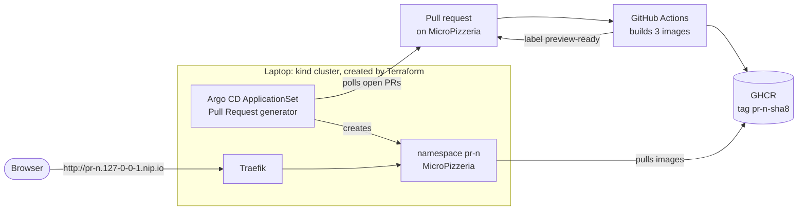

# PRVue

**An ephemeral Kubernetes preview environment for every pull request.**

## Demo

https://github.com/user-attachments/assets/dfcc7ff6-1cc6-4af8-918b-625a0db1dabf

Open a pull request → its own preview environment is created automatically → close the pull request → the environment is deleted.

## How it works



1. A pull request on [MicroPizzeria](https://github.com/sana-Benz/MicroPizzeria) triggers GitHub Actions, which builds its three images (`frontend`, `user-service`, `order-service`) from the PR's head commit and pushes them to GHCR as `pr-<number>-<first 8 chars of the SHA>`. Once all three builds succeed, the PR gets the `preview-ready` label.
2. An Argo CD ApplicationSet (Pull Request generator) lists the open PRs with that label and creates one Application per PR, deployed into its own namespace `pr-<number>`.
3. Traefik routes `http://pr-<number>.127-0-0-1.nip.io` to that namespace.
4. A new commit is rebuilt and rolled out in the same namespace; closing the PR deletes the Application, its namespace and its data.

**Key design choice:** GitHub Actions and Argo CD never talk to each other. Both derive the same image tag from the PR number and the commit SHA, so the image Argo CD deploys is exactly the one CI built from that commit.

**Stack:** kind, Terraform, Traefik, Argo CD, GitHub Actions, GHCR, Kustomize.

## MVP

The MVP covers the full lifecycle of a preview, with no manual command: **one pull request = one isolated environment**, created automatically, updated in place on every new commit, and deleted when the pull request is closed.

**Tested end to end** on MicroPizzeria PR #5: the preview was created automatically and reached *Synced / Healthy*; a second commit was rolled out in place (new pods ready before the old ones stopped, same namespace, database content kept); closing the PR deleted the Application, the namespace and its volumes in about a minute. Measured: CI ≈ 45 s per commit, cleanup ≈ 1 min after closing.

**Tag:** [`v0.1-mvp`](https://github.com/sana-Benz/PRVue/releases/tag/v0.1-mvp)

**Known limitations**
- **Demo-only secrets:** each preview's database passwords are throwaway values committed in MicroPizzeria (`preview-only-not-a-secret`). Real secrets would need a dedicated mechanism (Sealed Secrets, External Secrets…).
- **About 2 minutes of polling delay:** the cluster accepts no incoming connections, so there is no webhook; Argo CD checks GitHub every 120 s.
- **Local only:** everything runs on a kind cluster on one laptop.
- **No previews for PRs from forks:** their GitHub token is read-only, so CI can't publish their images.
- Each PR gets its own namespace, but **two automatic previews running at the same time have not been tested yet**.

### Why MicroPizzeria as the demo application

Instead of writing a toy app, I reused one of my own earlier projects, [MicroPizzeria](https://github.com/sana-Benz/MicroPizzeria):
- a realistic microservices app (an Nginx frontend, two Flask services, two MySQL databases);
- it already had Dockerfiles and Kubernetes manifests, so PRVue could focus on the platform rather than the app;
- its original standalone Minikube version is preserved under the tag `v1-minikube`; it was then adapted for PRVue (Kustomize, dynamic namespaces, Traefik routing, a CI workflow) without changing its application architecture.

## Design choices

| Choice | Why |
| --- | --- |
| **Two repositories** | MicroPizzeria holds the app, its manifests and its CI; PRVue holds the platform (Terraform, Argo CD). This mirrors a platform team providing tooling to application teams. |
| **Pull model (Argo CD polls GitHub)** | Every connection is outbound from the laptop: Argo CD reads GitHub and the cluster pulls images. Nothing is exposed to the Internet; port 80 only listens on `127.0.0.1`. |
| **The namespace as the only input** | Argo CD only sets the namespace (`pr-<n>`) and the image tags. Kustomize derives the rest from the namespace, including the hostname. |
| **A dedicated Argo CD project** | The `previews` AppProject only allows `pr-*` namespaces and the resource kinds MicroPizzeria uses, so a preview can never be deployed into `default` or a shared namespace (tested: such syncs are refused). |
| **Immutable image tags** | `pr-<n>-<sha8>` is built once per commit and never overwritten, so it is always clear which commit is running. A moving `pr-<n>` tag points to the latest build, for humans only. |
| **Traefik** | Lightweight, maintained ingress controller (ingress-nginx was retired). Each preview is routed by hostname. |
| **nip.io with a dashed IP** | `pr-12.127-0-0-1.nip.io` resolves to `127.0.0.1` with no DNS setup. The dotted form `pr-12.127.0.0.1.nip.io` is misread by nip.io as `12.127.0.0`. |
| **kind + Terraform** | A free local cluster, created and destroyed with one command. |

## 🚧 Coming soon

The MVP covers the core lifecycle. These features are next on the roadmap:

- Health checks after each deployment, with the preview URL posted on the pull request
- Monitoring of each preview environment
- Automatic cleanup of the images of closed pull requests
- Security scanning in CI (images, infrastructure code, secrets)
- Better secrets management for previews

## Getting started

**Prerequisites:** Docker, kind, kubectl, Terraform, Helm, and the MicroPizzeria repository with its preview workflow and a `preview-ready` label.

```bash
# 1. Foundation: kind cluster, Traefik and Argo CD
cd platform/terraform && terraform init && terraform apply && cd ../..
curl http://localhost        # "404 page not found": Traefik answers, nothing deployed yet

# 2. GitHub token for the Pull Request generator
#    (fine-grained, MicroPizzeria only, Pull requests + Metadata read-only; never commit it)
read -s GITHUB_TOKEN
kubectl create secret generic github-token -n argocd --from-literal=token="$GITHUB_TOKEN"
unset GITHUB_TOKEN

# 3. Previews
kubectl apply -f platform/argocd/appproject.yaml
kubectl apply -f platform/argocd/applicationset.yaml

# Then open a pull request on MicroPizzeria and watch:
kubectl get applications -n argocd -w
```

`terraform destroy` removes everything. Deleting the ApplicationSet deletes **all** preview environments.

## Repository layout

```
.
├── platform/
│   ├── argocd/
│   │   ├── appproject.yaml     # "previews" project: pr-* namespaces and MicroPizzeria kinds only
│   │   └── applicationset.yaml # one Application per PR labeled preview-ready
│   └── terraform/
│       ├── providers.tf        # kind and helm providers
│       ├── cluster.tf          # "previews" kind cluster, port 80 → 30080 on 127.0.0.1
│       ├── platform.tf         # Traefik and Argo CD (Helm charts, pinned versions)
│       └── values/             # chart settings
└── demo/
    ├── DEMO_SCRIPT.md          # demo steps, fallbacks and reset procedure
    └── prepare.sh              # read-only readiness check before a demo
```
